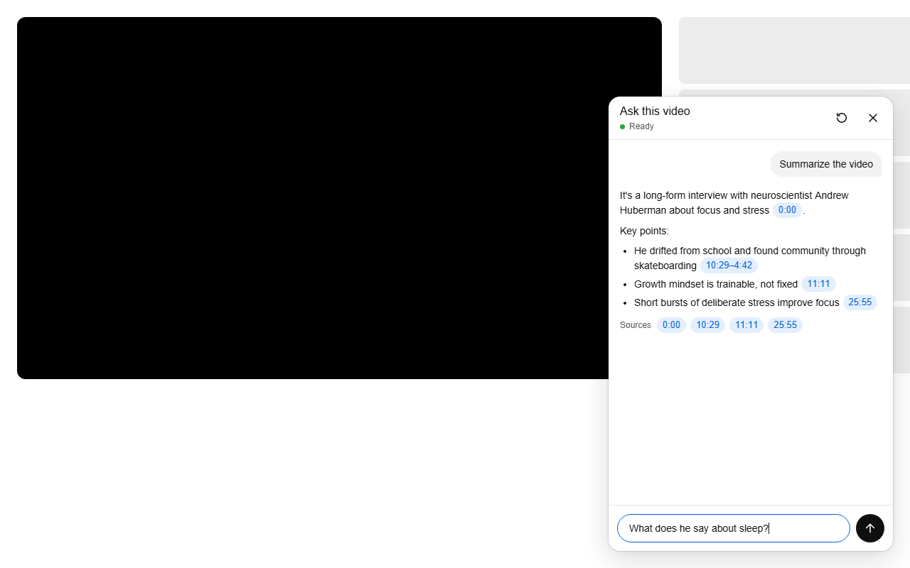

# Ask This Video

A Chrome extension that lets you chat with any YouTube video. Open the chat on a video, ask a question, and get an answer built from the video's transcript, with clickable timestamps that jump the player to the moment the answer came from.



## Features

- **Chat on the video page.** A floating button on every video (including Shorts) opens a chat panel. It follows YouTube's light and dark theme. Shortcut: <kbd>Alt</kbd>+<kbd>Shift</kbd>+<kbd>Y</kbd>.
- **Answers from the transcript.** Retrieval-augmented generation (RAG) over the video's captions, so answers stick to what is actually said.
- **Clickable timestamps.** Citations like `[12:34]` in answers, plus a row of sources under each answer, seek the video when clicked.
- **One conversation per video.** Switching videos keeps each chat separate, and follow-up questions use the recent chat history.
- **Fast repeat visits.** Each video is indexed once, then served from memory or from disk.

## How it works

```
YouTube page                Chrome extension               Python backend (FastAPI)
─────────────               ────────────────               ────────────────────────
chat panel  ──message──▶   service worker  ──HTTP──▶     /videos/{id}/ingest
(content script)                                           1. youtube-transcript-api fetches captions
                                                           2. caption lines grouped into ~1000-char chunks
                                                           3. chunks embedded locally (all-MiniLM-L6-v2)
                                                           4. stored in a FAISS index per video

                                                         /chat
                                                           1. top-4 chunks retrieved for the question
                                                           2. chunks + history + question → Groq LLM
            ◀────────────── answer + timestamped sources ──┘
```

- The **extension** draws the chat panel inside a Shadow DOM, so YouTube's CSS can't affect it. It sends requests through its service worker, which avoids cross-origin (CORS) restrictions on the YouTube page.
- The **backend** builds chunks from whole caption lines rather than raw text, so every chunk keeps its start time. That's what makes clickable timestamps possible.
- **Embeddings run locally** with a sentence-transformers model, so they need no API key. Only answer generation calls an external API (Groq).

## Tech stack

| Part | Built with |
|---|---|
| Extension | Manifest V3, plain JavaScript and CSS (no build step) |
| API | FastAPI, Pydantic, Uvicorn |
| Transcripts | [youtube-transcript-api](https://github.com/jdepoix/youtube-transcript-api) |
| RAG | LangChain, FAISS, HuggingFace `sentence-transformers/all-MiniLM-L6-v2` |
| LLM | [Groq](https://groq.com) (`openai/gpt-oss-120b` by default) |

## Getting started

### Requirements

- Python 3.10+
- Google Chrome (or another Chromium browser)
- A [Groq API key](https://console.groq.com/keys) (free tier available)

### 1. Run the backend

```bash
cd backend
python -m venv .venv
# Windows: .venv\Scripts\activate    macOS/Linux: source .venv/bin/activate
pip install -r requirements.txt

cp .env.example .env    # then set GROQ_API_KEY in .env
uvicorn app.main:app
```

The API runs at `http://127.0.0.1:8000`, with interactive docs at `/docs`. The first request downloads the embedding model (about 90 MB), once.

### 2. Load the extension

1. Open `chrome://extensions` and turn on **Developer mode**.
2. Click **Load unpacked** and select the `extension/` folder.
3. Open any YouTube video (reload tabs that were already open) and click the chat button in the bottom-right corner.

The toolbar popup shows whether the backend is reachable and whether a Groq key is set. You can also change the backend URL there.

## Configuration

All settings are environment variables, read from `backend/.env` or a `.env` in the project root. Variables set in your system environment take priority over both files.

| Variable | Default | Purpose |
|---|---|---|
| `GROQ_API_KEY` | — | Required for answers |
| `GROQ_MODEL` | `openai/gpt-oss-120b` | Any chat model available to your Groq key |
| `LLM_TEMPERATURE` | `0.2` | Lower means more literal answers |
| `EMBEDDING_MODEL` | `sentence-transformers/all-MiniLM-L6-v2` | After changing it, delete `backend/vectorstore/*` so indexes are rebuilt |
| `CHUNK_SIZE` / `CHUNK_OVERLAP` | `1000` / `200` | Chunk length and overlap, in characters |
| `TOP_K` | `4` | Chunks retrieved per question; raise it for "list everything" questions |
| `TRANSCRIPT_LANGUAGES` | `en` | Comma-separated preference order. Falls back to any available transcript |

## API

| Method | Path | Description |
|---|---|---|
| `GET` | `/health` | Status, plus whether a Groq key is configured |
| `POST` | `/videos/{video_id}/ingest` | Fetch and index a transcript. Add `?force=true` to rebuild |
| `POST` | `/chat` | `{video_id, question, history[]}` → `{answer, sources[]}`. Indexes the video first if needed |

Errors use plain status codes: `404` means the video has no transcript, `422` means an invalid video ID or request, and `503` means `GROQ_API_KEY` isn't set.

## Project structure

```
extension/
  manifest.json              permissions, content script, keyboard shortcut
  content/content.js         chat panel (Shadow DOM), navigation watcher, timestamp seeking
  content/chat-widget.css    panel styles, light and dark
  background/service-worker.js   proxies API calls to the backend
  popup/                     toolbar popup: backend status and settings
backend/
  app/main.py                FastAPI app, CORS, error handlers
  app/api/routes.py          /health, /videos/{id}/ingest, /chat
  app/services/transcript.py fetches and validates transcripts
  app/services/vector_store.py   chunking and per-video FAISS indexes (memory → disk → build)
  app/services/embeddings.py local HuggingFace embedding model
  app/services/rag_chain.py  retrieval, prompt, Groq call
  app/core/config.py         settings from the environment
  tests/                     offline tests (no network, no model download)
```

## Tests

```bash
cd backend
python -m pytest
```

The tests cover chunking, video ID validation, the API layer (with the RAG calls mocked) and the helper functions. They need no network access and no API key.

## Limitations

- **Runs locally.** The extension expects the backend on `localhost` / `127.0.0.1` by default. For a public deployment, you would need to host the backend and add rate limiting. Also note that YouTube often blocks transcript requests from cloud servers, so a proxy may be needed.
- **Text only.** The model sees the transcript, never the video itself, so questions about visuals can't be answered.
- **Videos need captions.** Videos without captions (including auto-generated ones) can't be indexed.
- **YouTube's terms.** Fetching transcripts automatically may conflict with YouTube's Terms of Service. This project is meant for personal and educational use.

## License

[MIT](LICENSE)
